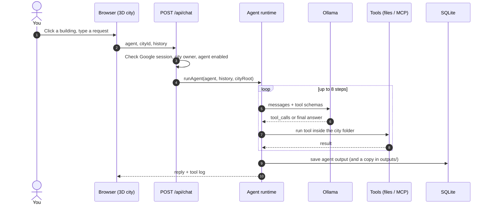
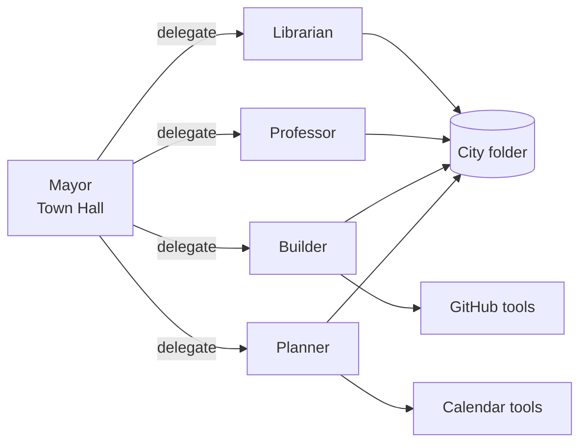

<p align="center">
 

</p>

<p align="center">
  
  
  
  
  
  
  
  
</p>

<h1 align="center">Agent City</h1>

<p align="center">
  <b>A town of five local AI agents that organize, study, build and plan inside one folder on your laptop.</b><br>
  Free · private · runs on <a href="https://ollama.com">Ollama</a> · no cloud inference, no API key.
</p>

---

## Table of contents

- [What is Agent City?](#what-is-agent-city)
- [Meet the agents](#meet-the-agents)
- [Features](#features)
- [System design](#system-design)
- [Quick start](#quick-start)
- [Configuration](#configuration)
- [Using Agent City](#using-agent-city)
- [Google Calendar and GitHub tools](#google-calendar-and-github-tools)
- [Document Studio](#document-studio)
- [Scheduled jobs](#scheduled-jobs)
- [A2A agent access](#a2a-agent-access)
- [Security model](#security-model)
- [Project structure](#project-structure)
- [Tips for small models](#tips-for-small-models)
- [Roadmap](#roadmap)
- [Contributing](#contributing)

---

## What is Agent City?

Agent City turns a normal folder into a small 3D town. Each building is an AI agent with one job and one part of the folder it owns. You click a building, give it a short instruction, and it uses real tools to list, read, write and move files for you.

- **Local first.** Inference goes to your own Ollama server. Files never leave your machine.
- **Safe by design.** Agents are confined to one city folder, cannot delete anything, and never overwrite on move.
- **Interoperable.** Built-in MCP tools for Google Calendar and GitHub, plus an inbound **A2A v1.0** endpoint so other agents can call yours.
- **One process.** Next.js, SQLite and the scheduler run together. There is no separate backend service.

## Meet the agents

| Agent | Building | Owns | What it does |
|---|---|---|---|
| **Mayor** | Town Hall | routing | Takes any request, splits it up and delegates to the right worker, then summarizes. Edits no files itself. |
| **Librarian** | Library | `/Library` | Sorts and renames loose files and keeps `/Library/INDEX.md` up to date. |
| **Professor** | Campus | `/Courses` | One folder per course with `notes.md`, `assignments.md`, `revision.md`. Makes summaries, flashcards and exam checklists. |
| **Builder** | Workshop | `/Projects` | Keeps `README.md` and `TODO.md` per project. Reads code before commenting. Gets GitHub issue/PR tools. |
| **Planner** | Planner's Office | `/Planner` | Maintains `tasks.md` and `week.md`. Gets Google Calendar tools. |

## Features

- **Interactive 3D city** built with React Three Fiber. Click a building to talk to its agent, drag to orbit, scroll to zoom.
- **Multi-agent delegation.** The Mayor runs a tool-calling loop and can delegate several tasks in parallel.
- **Sandboxed file tools:** `list_dir`, `read_file`, `write_file`, `make_dir`, `move`.
- **Google Calendar tools** for the Planner: list, create and update events on your primary calendar.
- **GitHub tools** for the Builder: read repos, search and manage issues, read and write issue comments.
- **Document Studio:** upload PDFs, text and Markdown into a per-city knowledge library, then draft, edit and judge documents against cited evidence.
- **Weekly scheduled jobs** per city with weekday, time and IANA time zone, plus Run now, pause and delete.
- **Per-user settings:** choose the Ollama model, `CITY_ROOT` and which agents are enabled.
- **A2A v1.0 server** with a public Agent Card at `/.well-known/agent-card.json`.
- **Google sign-in** via Auth.js, with refresh tokens encrypted at rest.

## System design

<p align="center">
  
</p>

How a chat request travels through the system:




Mayor delegation:



## Quick start

**Prerequisites:** Node.js 20+, [Ollama](https://ollama.com), a Google Cloud OAuth client.

```bash
# 1. Pull the default model
ollama pull llama3.2:3b
ollama list                      # confirm it is installed

# 2. Clone and install
git clone https://github.com/<your-username>/AI_AGENT-CITY.git
cd AI_AGENT-CITY
npm install

# 3. Create your environment file
cp .env.example .env.local       # Windows: copy .env.example .env.local
```

Edit `.env.local` and set at least `AUTH_SECRET`, `AUTH_GOOGLE_ID` and `AUTH_GOOGLE_SECRET`.
Generate a secret with `openssl rand -base64 32`.

**Google OAuth setup**

1. In Google Cloud Console, create an OAuth 2.0 Web client.
2. Enable the **Google Calendar API**.
3. Add `http://localhost:3000/api/auth/callback/google` as an authorized redirect URI.

```bash
# 4. Run
npm run dev
```

Open <http://localhost:3000>. You will be sent to the sign-in page. After signing in, click **Build city** on the dashboard.

For production: `npm run build && npm start`, and set `A2A_PUBLIC_URL` to your public HTTPS origin.

## Configuration

| Variable | Required | Default | Purpose |
|---|---|---|---|
| `OLLAMA_URL` | no | `http://localhost:11434` | Ollama server address |
| `OLLAMA_MODEL` | no | `llama3.2:3b` | Initial model (changeable later in Settings) |
| `CITY_ROOT` | no | `~/AgentCity` | Parent folder for all cities. Agents cannot leave it. |
| `AUTH_SECRET` | **yes** | none | Signs sessions and encrypts Google refresh tokens. Keep it stable. |
| `AUTH_GOOGLE_ID` | **yes** | none | Google OAuth client ID (also the A2A token audience) |
| `AUTH_GOOGLE_SECRET` | **yes** | none | Google OAuth client secret |
| `A2A_PUBLIC_URL` | prod only | `http://localhost:3000` | Public HTTPS origin used in the Agent Card |
| `GITHUB_TOKEN` | no | none | Enables the Builder's GitHub tools |

`.env.local` and `data/` are git-ignored.

## Using Agent City

1. **Build a city** on the dashboard. This creates a unique subfolder inside `CITY_ROOT`.
2. **Click a building** and give it one short, single-step request, for example:
   - Librarian: *"Sort the loose files in the root into folders and update INDEX.md."*
   - Professor: *"Turn my DBMS notes into a revision sheet with 10 flashcards."*
   - Builder: *"Read the project README and write a TODO list with next steps."*
   - Planner: *"Add a task for the OS assignment due Friday and put it in this week's plan."*
3. Or talk to the **Mayor** for multi-step requests and let it delegate.
4. Open **Documents** for Document Studio, **Schedules** for weekly jobs, **Settings** to change model or agents.

Agents can read, write, create folders and move files. They cannot delete, and moves never overwrite.

## Google Calendar and GitHub tools

Agent City hosts a local, in-process MCP server. No extra process is needed.

| Agent | Tools |
|---|---|
| Planner | `google_calendar_list_events`, `google_calendar_create_event`, `google_calendar_update_event` |
| Builder | `github_get_repository`, `github_list_repo_issues`, `github_search_issues`, `github_create_issue`, `github_update_issue`, `github_list_issue_comments`, `github_create_issue_comment`, `github_update_issue_comment` |

No tool deletes events, issues or comments, and none pushes code.

- **Calendar:** sign-in requests Calendar event access. After configuring the app, sign out and sign in again to grant it. The refresh token is encrypted with `AUTH_SECRET` and stored in SQLite.
- **GitHub:** set `GITHUB_TOKEN` and restart. Use a fine-grained token limited to the repos you want, with **Metadata: read**, **Issues: read/write** and **Pull requests: read**. Do not grant Contents or code-push permissions.

## Document Studio

Open **Documents** from a city page for the PDF Maker, Editor and Judge workflow.

- **Maker and Editor** call your Ollama model only (no Google, no MCP). Edit the Markdown draft, save it into the knowledge library, and use **Print / Save as PDF** to export.
- **Knowledge library:** upload files or whole folders of PDF, TXT and Markdown. Text is extracted, split into overlapping chunks (1,600 characters, 200 overlap) and indexed in SQLite. Identical bytes are de-duplicated.
- **Limits:** 20 MB per file, 50 MB per batch, 200 pages per PDF. Scanned or image-only PDFs are not OCR'd.
- **Judge:** retrieves the six most relevant passages with BM25 ranking, builds a cited evidence brief, sends the task to an enabled worker, then asks the Mayor for a final evidence-based review. Enable the Mayor and at least one worker in Settings.

## Scheduled jobs

Create weekly jobs from a city's page: pick an agent, a task, a weekday, a local time and an IANA time zone (default: Sunday 01:50, `Asia/Kolkata`).

- Jobs are stored in SQLite and checked by a local scheduler that starts with the Node.js server. **It does not run while the server is stopped.**
- A job can read and modify files in its city folder. Its final output is saved to SQLite and to the city's `outputs/` folder.
- Nothing is created automatically, and jobs do not create Calendar events by default.

## A2A agent access

Agent City exposes an inbound **A2A v1.0** JSON-RPC endpoint at `/api/a2a` and a public Agent Card at `/.well-known/agent-card.json`. External A2A clients can discover it and submit tasks to an enabled agent in one of the caller's cities. It does not call arbitrary remote agents.

- **Auth:** every request needs `Authorization: Bearer <Google ID token>`. The token audience must equal `AUTH_GOOGLE_ID`, and the account must have signed in once. Browser session cookies are not accepted.
- **Routing:** for `SendMessage`, put routing in the user message metadata:

```json
{
  "agentCity": {
    "cityId": 1,
    "agentId": "librarian"
  }
}
```

`agentId` is one of `mayor`, `librarian`, `professor`, `builder`, `planner`. The city must belong to the caller and the agent must be enabled in their Settings. Content type is currently `text/plain`.

- **Production:** set `A2A_PUBLIC_URL` to an HTTPS origin and serve the app over HTTPS only.

## Security model

| Concern | How it is handled |
|---|---|
| File access | Every path is resolved and checked to stay inside the city folder. Symlink escapes are rejected. |
| Destructive actions | No delete tool exists. `move` refuses to overwrite. |
| Multi-user isolation | Every API route resolves the Google user and checks city ownership. |
| Secrets | Google refresh tokens are encrypted with `AUTH_SECRET`. `.env.local` and `data/` are git-ignored. |
| Integrations | GitHub token scope is read/write issues only. Calendar and GitHub tools have no delete or push. |
| Privacy | Inference uses your configured `OLLAMA_URL` (local by default). |

## Project structure

```
app/
  api/            chat, cities, documents, schedules, settings, a2a, auth
  city/[id]/      3D scene, workspace, Document Studio
  dashboard/      city list
  login/ settings/
lib/
  agents.ts           the five agents and their prompts
  run.ts              Ollama tool-calling loop and delegation
  fs-tools.ts         sandboxed file tools
  mcp-integrations.ts in-process MCP server (Calendar + GitHub)
  scheduler.ts        weekly job runner
  document-library.ts extract, chunk and BM25 retrieval
  a2a-server.ts       A2A executor and Agent Card
  db.ts               SQLite schema (data/city.db)
instrumentation.ts    starts the scheduler with the server
```

## Tips for small models

- Talk to one building at a time first. Mayor delegation is harder for a 3B model.
- Give short, single-step requests.
- For better results, set a larger model such as `qwen2.5:7b` with `OLLAMA_MODEL` or in Settings. It must already be installed in Ollama.

## Roadmap

- [ ] Streaming responses and live tool-call feed in the UI
- [ ] Pluggable model providers (Ollama, Claude, OpenAI) behind one interface
- [ ] Embedding-based retrieval alongside BM25
- [ ] OCR for scanned PDFs
- [ ] Automated tests and CI
- [ ] One-command Docker setup

## Contributing

Issues and pull requests are welcome. Please open an issue first for larger changes, keep tools non-destructive, and never commit `.env.local` or `data/`.

## License

Add a `LICENSE` file (MIT is a good default) before publishing.

---

<p align="center">Built by Siddharth · Next.js · Ollama · MCP · A2A</p>
